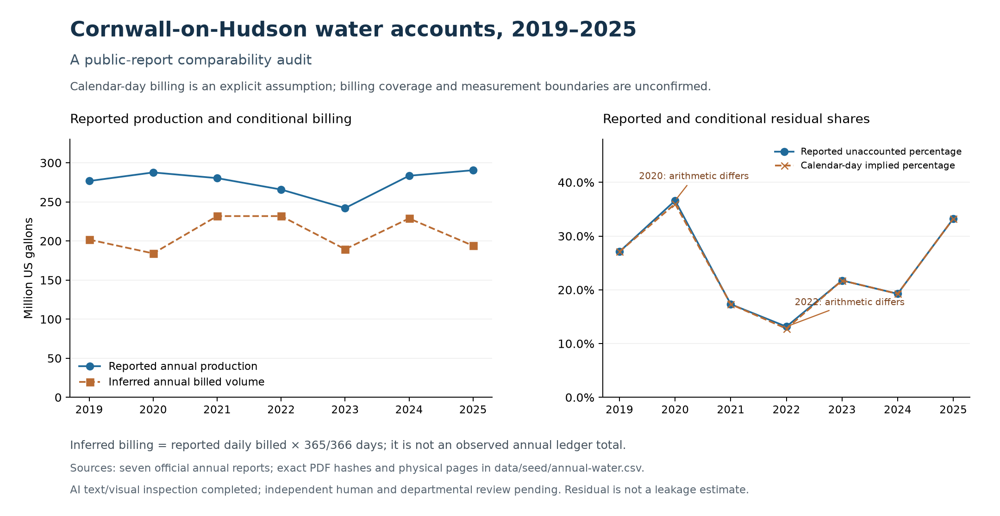

# Cornwall-on-Hudson water accounts, 2019–2025

**Are the 2024 and 2025 reported accounts comparable, and how much of the apparent change can documented periods, definitions and adjustments explain?** This independent research project begins with a public-report comparability audit.

The first research increment is available: [seven-year annual audit](reports/annual-audit.md), [reported and derived table](reports/annual-audit.csv), and [2024–2025 reconciliation bridge](reports/reconciliation-bridge.md). All seven accounting pages have AI text and visual checks tied to exact PDF hashes. Independent human review and departmental confirmation remain pending.

The calendar-day check flags differences in 2020 and 2022. The 2024/2025 percentages are arithmetically compatible, while billing coverage, denominator practice and measurement boundaries remain unconfirmed. The bridge attributes no amount to a documented cause. Unaccounted water includes authorized unbilled uses and possible losses.



Read [START_HERE](START_HERE.md), the [revised brief](research/brief.md), [status](research/STATUS.md), [hypothesis matrix](research/hypothesis-evidence.csv) and [focused departmental request](research/questions-for-water-department.md). No request has been sent.

## Reproduce the audit

```sh
uv sync --locked
make check
make preflight
```

`make preflight` uses the pinned observations and retrieval receipts; if matching original PDFs exist locally, it checks their hashes too. Missing originals are explicitly reported. `make fetch` retrieves new local snapshots but never silently rebinds an existing observation to a later hash. `make extract` aids transcription; Poppler is required for the complex 2019 PDF. See [data guidance](data/README.md).

Production periods, report testing coverage, billed-volume coverage, billing denominators and customer/measurement boundaries are separate inputs. Annual billed totals remain inferred. Seven annual observations support descriptive accounting.

This public repository contains reviewed English documents, code, schemas, receipts and aggregate results. Raw PDFs and record-level working files stay local and ignored. Departmental cooperation and novelty are unestablished. Five existing agent roles are available; no background process or independent reviewer is implied. Further workspace engineering is paused in favor of evidence work.
